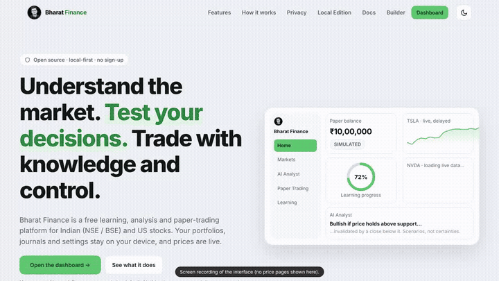
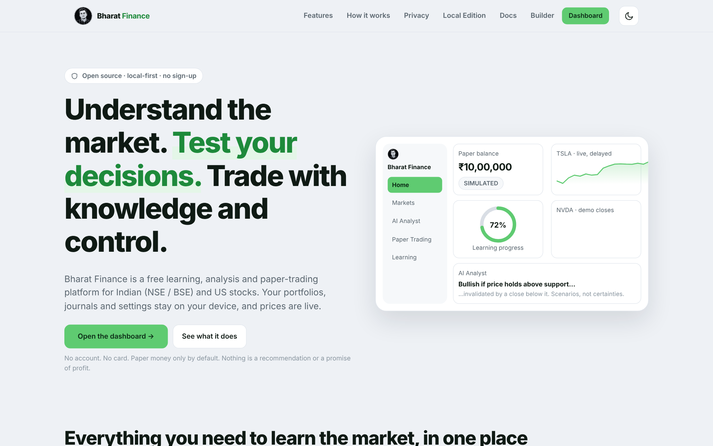
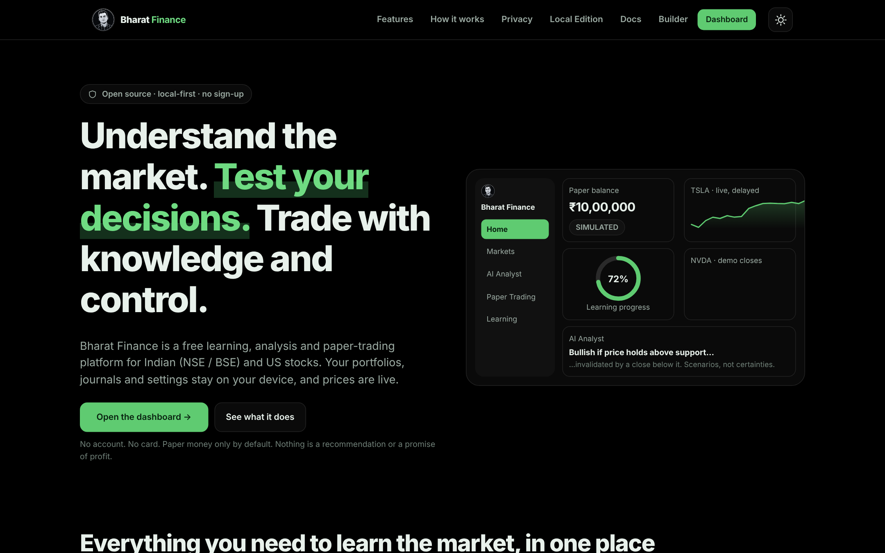
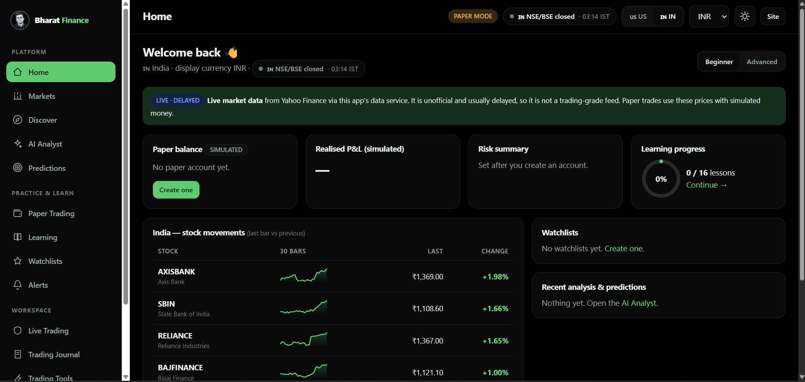
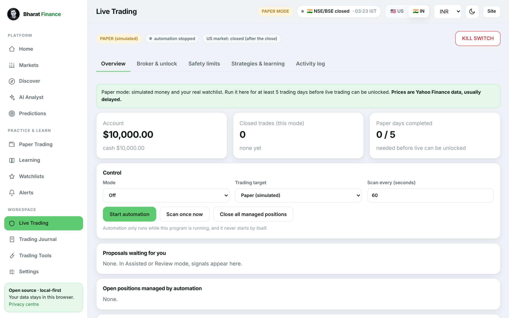
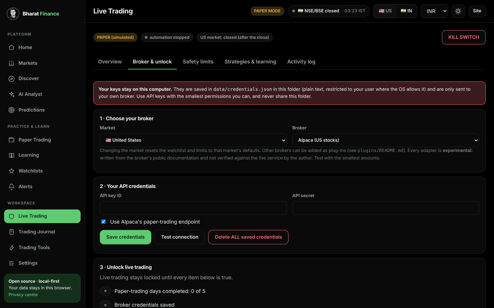
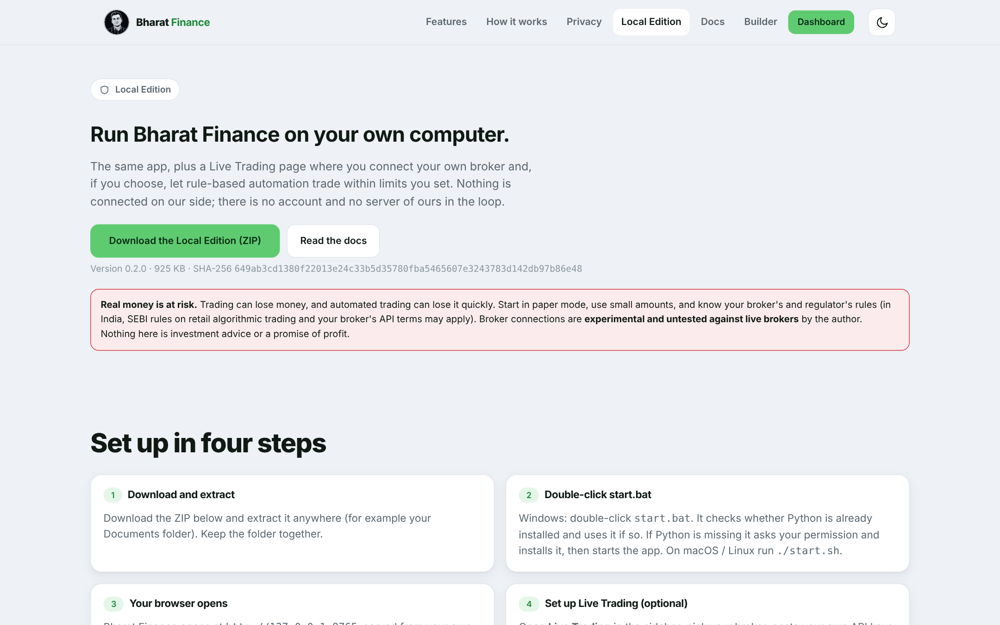
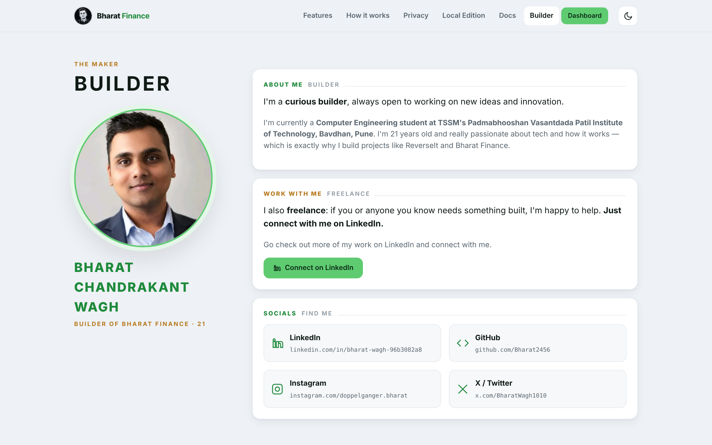
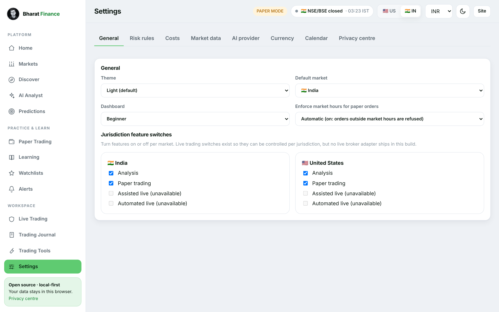

<div align="center">


# Bharat Finance

**Learn the market. Test your decisions. Trade with knowledge and control.**

A free, open-source platform for **Indian (NSE/BSE) and US stocks**: live delayed market data, an AI analyst that explains the numbers, paper trading, a trading journal, and an optional **Local Edition** with rule-based automated trading that runs entirely on your own computer.

[](https://bharat-finance.vercel.app)
[](https://bharat-finance.vercel.app/local)


<br>



<sub>Full recording: <a href="docs/media/bharat-finance-walkthrough.mp4">docs/media/bharat-finance-walkthrough.mp4</a></sub>

</div>

---

## Why Bharat Finance

Most trading apps ask you to sign up, hand over data and then nudge you to trade. Bharat Finance does the opposite:

- **Real market data.** No demo or synthetic prices anywhere. If data can't be fetched, the app says so.
- **Your data stays with you.** Portfolios, journals and settings live in your browser (hosted) or in a folder on your computer (Local Edition). No accounts, no analytics, no ads.
- **Explains instead of promising.** The AI analyst describes what the numbers show and what would change the picture. It never promises profit.
- **Safe by design.** Paper money by default. Live trading is off, locked, and guarded by hard limits that live in the program, not in the web page.

## Screenshots

<table>
<tr>
<td width="50%"><br><sub><b>Landing page</b>: light theme (the default on every visit)</sub></td>
<td width="50%"><br><sub><b>Dark theme</b>: pure black background</sub></td>
</tr>
<tr>
<td width="50%"><br><sub><b>Dashboard</b> with live, delayed NSE prices</sub></td>
<td width="50%"><br><sub><b>Live Trading console</b> (Local Edition)</sub></td>
</tr>
<tr>
<td width="50%"><br><sub><b>Broker setup</b> and the unlock checklist</sub></td>
<td width="50%"><br><sub><b>Local Edition</b> download page</sub></td>
</tr>
<tr>
<td width="50%"><br><sub><b>Builder</b> page</sub></td>
<td width="50%"><br><sub><b>Settings</b>: data, AI and privacy</sub></td>
</tr>
</table>

## Features

| | |
|---|---|
| **Markets** | India (NSE/BSE, ₹) and US, live (delayed) prices, charts, movers, symbol search, news and SEC filings |
| **AI Analyst** | Explains indicators, risk and scenarios in plain language. Works with no AI at all (built-in explainer), or with your own key for Gemini, OpenAI-compatible, Anthropic or a local model. **Models are discovered automatically.** |
| **Predictions** | Scenario-based views with the conditions that would invalidate them, tracked over time |
| **Paper Trading** | Simulated accounts in ₹ or $, with costs and slippage, on real prices |
| **Learning** | 16 beginner-to-advanced lessons |
| **Watchlists, Alerts, Journal** | Everything stored on your device |
| **Trading Tools** | Entry and exit planning, position sizing, budget, Monte Carlo simulation and more |
| **Live Trading** *(Local Edition)* | Your own broker keys; Review, Assisted or Automated modes; strict limits; kill switch; adaptive strategy learning |
| **Light and dark themes** | Light by default on every visit; dark mode is pure black |

## Two editions

### Hosted site
Deploy once to Vercel and share the link. A small serverless data relay (`api/`) fetches real prices so the browser can show them.

### Local Edition
Download the ZIP from the site's **Local Edition** page, extract it and double-click **`start.bat`** (Windows) or run `./start.sh` (macOS / Linux). It checks whether Python 3.9+ is already installed, uses it if so, and only offers to install it if it is missing. Everything then runs at `http://127.0.0.1:8765` on your own machine.

The Local Edition adds the **Live Trading** console:

1. **Paper first.** A simulated account runs your rules on real prices.
2. **Adaptive learning.** Strategies are back-tested with a 70/30 walk-forward split. A strategy gets full size only if it shows an edge on unseen data, otherwise half size, and it is paused if recent results are poor. It can never raise your limits.
3. **Unlock live.** Requires the paper-trading period, your own broker API keys and a typed confirmation.
4. **Hard limits on every order:** stop required, max loss per trade, max order value, daily loss halt, max trades, max positions, minimum reward:risk, blocked symbols, market hours, fresh data, no short selling. A **kill switch** stops everything.

> Trading involves risk of loss. Automation is rule-based (no AI model places orders) and does not predict profit. Broker adapters (Alpaca for the US, Zerodha Kite for India) are experimental: test with very small amounts. In India, check SEBI/exchange rules and your broker's API terms before automating real orders.

## Market data

| Source | Role |
|---|---|
| Yahoo Finance (via the site's own relay) | Default, free, unofficial, usually delayed |
| Twelve Data / Alpha Vantage | Optional backups: set `TWELVEDATA_API_KEY` or `ALPHAVANTAGE_API_KEY` as Vercel environment variables (server-side only) |
| Last saved copy | If every source fails, the last real data loaded in your browser is shown, labelled with its age |

Open `/api/diag` on your deployment to see exactly which sources answer. Details: [MARKET_DATA.md](MARKET_DATA.md).

## Quick start

```powershell
# Requires Node 18+. No packages to install.
npm run dev          # http://localhost:5173 (includes the data relay)
npm test             # JavaScript tests
npm run test:local   # Local Edition (Python) tests
npm run build        # validates and writes dist/
npm run local        # run the Local Edition from source (Python 3.9+)
npm run pack:local   # rebuild the downloadable Local Edition ZIP
```

### Deploy to Vercel
1. Push this repository to GitHub.
2. In Vercel: **Add New → Project**, import the repo. Framework **Other**, build command `npm run build`, output directory `dist`.
3. *(Recommended)* Add `TWELVEDATA_API_KEY` under **Settings → Environment Variables**, then redeploy.
4. Check `/api/health` and `/api/diag`.

More: [DEPLOYMENT.md](DEPLOYMENT.md) · [INSTALLATION.md](INSTALLATION.md) · [LOCAL_EDITION.md](LOCAL_EDITION.md)

## Project structure

```
web/        front end (vanilla JS, native ES modules, no bundler)
api/        hosted data relay (Vercel functions, zero dependencies)
local/      Local Edition: Python standard-library program, launchers, plug-ins
scripts/    build, dev server, Local Edition packer
tests/      JavaScript and Python test suites
docs/       screenshots and walkthrough video
```

## Documentation

[Architecture](ARCHITECTURE.md) · [Market data](MARKET_DATA.md) · [AI providers](AI_PROVIDERS.md) · [Paper trading](PAPER_TRADING.md) · [Broker integration](BROKER_INTEGRATION.md) · [Local Edition](LOCAL_EDITION.md) · [Privacy](PRIVACY.md) · [Security](SECURITY.md) · [Deployment](DEPLOYMENT.md) · [Test report](TEST_REPORT.md) · [Contributing](CONTRIBUTING.md)

## Good to know

- Prices are **delayed** and come from unofficial or licensed-vendor sources, not an exchange feed.
- The India holiday calendar is partial (weekends, fixed dates and holidays you add).
- Local Edition broker keys are stored unencrypted in the `data/` folder on your computer. Never share it.
- Live Yahoo access, the broker adapters and `start.bat` on Windows have not been verified against every environment; see [TEST_REPORT.md](TEST_REPORT.md).
- Educational software. Not investment advice.

## Creator

**Bharat Chandrakant Wagh** designed and created Bharat Finance.

## License

[MIT](LICENSE) © 2026 Bharat Chandrakant Wagh
